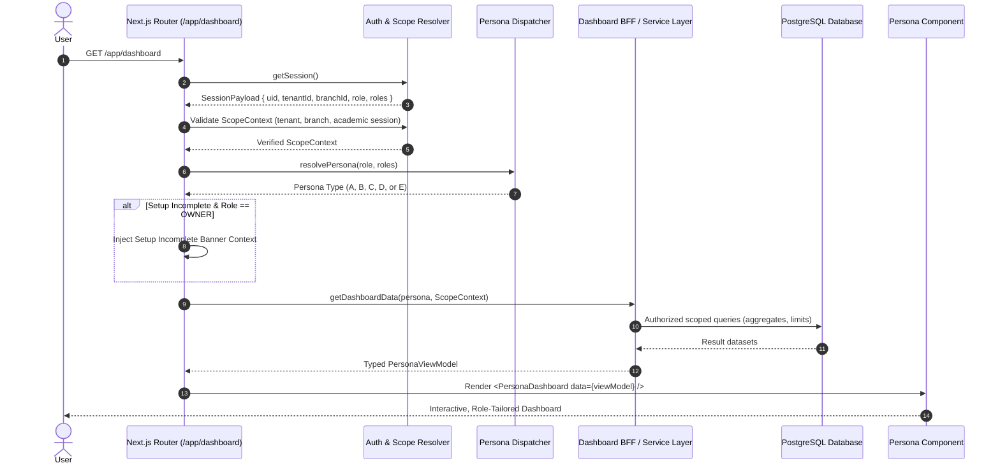

# PreOne — Phase 02: Role-Based Dashboard Architecture Specification

**Document ID:** PREONE-ARCH-DASH-02  
**Version:** 1.0  
**Status:** Proposed Architecture Baseline  
**Based on:** Phase 01-A Audit Verification & Final Evidence Reconciliation  
**Target Repository:** `Nuke0140/pre1`  
**Target Baseline Commit:** `3e0b7615ae4bc3257a11512e00f3377a24daa7f1`  

---

## 1. Purpose

This document defines the comprehensive architecture, role-based dashboard behavior, information architecture, navigation model, data-access boundaries, widget ownership, responsive strategy, performance criteria, and acceptance test specifications for the PreOne dashboard.

This specification establishes the authoritative, intended design baseline before any implementation begins in Phase 03.

### Explicit Product Decisions (Approved in Phase 01-A)

1. **Setup Preview for School Owners:** School Owners (`OWNER`) may preview the dashboard while school setup is incomplete, accompanied by a persistent, non-blocking **Setup Incomplete** banner with actionable setup links and progress tracking.
2. **Draft Invoice Exclusion & Separation:** Draft invoices (`status: DRAFT`) are strictly excluded from "Total Billed" revenue figures and displayed separately as an operational indicator ("Draft Invoices Pending Dispatch") on the Finance dashboard.
3. **Single Route with Dynamic Persona Mounting:** `/app/dashboard` remains the single, unified dashboard URL. The application dynamically mounts a dedicated role-specific dashboard component based on the authenticated user's canonical role, eliminating generic fallthrough for specialized staff personas.

### Strict Scope Restrictions

This phase defines architecture and implementation requirements only:
- Zero production code changes.
- Zero CSS changes.
- Zero database schema changes.
- Zero RBAC changes.
- Zero API implementation.
- Zero dashboard redesign implementation.
- No claim that any proposed behavior is already implemented.

---

## 2. Architecture Principles

### 2.1 One Dashboard Route, Multiple Role Experiences
- `/app/home` serves as the preschool application **launchpad and module switcher**, presenting a high-level catalog of accessible modules.
- `/app/dashboard` serves as the **live operational command center**, dynamically adapting its user experience, telemetry, and actions to the user's specific operational role.
- Specialized operational staff (`ACCOUNTS`, `RECEPTIONIST`, `ATTENDANT`, `DRIVER`) must never fall through to a generic administrator dashboard.

### 2.2 Server-Side Authorization is Authoritative
- Hiding a card, tab, button, or link in the UI is a presentation convenience, **not a security boundary**.
- All data retrieval and mutation actions must be authorized server-side based on the authenticated session's effective permissions and resource ownership.
- Client components must receive only the specific data fields authorized for that role.

### 2.3 Explicit, Multi-Dimensional Data Scoping (`ScopeContext`)
Every dashboard query and service call must derive its scope from the verified server session context:
- `tenantId`: Mandatory multi-tenant boundary.
- `branchId`: Multi-campus physical branch boundary (where applicable).
- `academicSessionId`: Academic year operational boundary (mandatory for financial and enrollment metrics).
- `userId` / `actorId`: Authenticated user identity.
- Canonical role and effective capability set (`can(role, capability)`).
- Resource ownership constraints (e.g. assigned classroom sections for teachers, linked student wards for parents/guardians).
- The server must validate that the requested `branchId` and `academicSessionId` belong to the authenticated tenant and are accessible to the user.

### 2.4 Reuse Authoritative Domain Services
- Dashboard endpoints and view composers must delegate data fetching and calculations to existing, authoritative domain services (`ReportService`, `OperationsService`, `FeeService`, `StudentService`, `CapacityService`).
- Redundant, inline database math (such as in-memory invoice reductions in page components) is strictly prohibited.

### 2.5 Accessibility and Responsive Behavior by Default
- Every role persona dashboard must provide first-class responsive support across desktop, tablet, and mobile form factors.
- Loading states (using standardized loaders), empty states, error boundaries, and restricted-access states must be explicitly designed for every widget.

---

## 3. Application Information Architecture

### 3.1 Primary Application Destinations

```
┌────────────────────────────────────────────────────────────────────────┐
│                              APP SHELL                                 │
│  (Header, Logo, Tenant Badge, Campus Selector, Global Search, Profile) │
└────────────────────────────────────────────────────────────────────────┘
                                    │
         ┌──────────────────────────┴──────────────────────────┐
         ▼                                                     ▼
┌──────────────────┐                                ┌──────────────────┐
│    /app/home     │                                │  /app/dashboard  │
│ Launchpad & Hub  │                                │ Command Center   │
└──────────────────┘                                └──────────────────┘
         │                                                     │
         ├─ Module Cards Grid                                  ├─ Persona A: Executive (Owner, Principal)
         ├─ Daily Operating Loop Shortcuts                     ├─ Persona B: Academic Ops (Teacher, Coordinator)
         └─ Deep Module Navigation                             ├─ Persona C: Finance (Accounts)
                                                               ├─ Persona D: Front-Desk & Logistics (Staff)
                                                               └─ Persona E: Family Portal (Parent, Guardian)
```

| Destination | Primary Responsibility | Target Personas |
| :--- | :--- | :--- |
| `/app/home` | System launchpad, module directory, preschool branding, quick operational jumping points. | All authenticated roles |
| `/app/dashboard` | Role-specific live command center, action items, immediate alerts, operational telemetry. | Role-customized per persona |
| `/app/setup` | School onboarding wizard, campus configuration, step-by-step setup dependencies. | `OWNER`, `PRINCIPAL` |
| `/app/students` | Comprehensive student directory, Visual Photo Roster, Student 360 Slide-Over Drawer. | Authorized Staff |
| `/app/daily-diary`| Daily classroom logs, attendance registers, routine care tracking, observations. | Educators & Staff |
| `/app/fees` | Fee schedules, invoice management, offline collections, ledger reconciliation. | Finance & Admin |
| `/app/admissions` | Inquiries, admissions pipeline, document verification, enrollment allocation. | Admissions & Admin |
| `/app/settings` | Multi-branch configuration, academic calendar, operating hours, policies. | Admin & Leadership |

### 3.2 Dashboard Rendering Flow



---

## 4. Role-Specific Dashboard Personas

### 4.1 Persona A — Executive Dashboard
- **Canonical Roles:** `OWNER`, `PRINCIPAL`
- **Purpose:** Provide an overarching operational, strategic, and financial pulse of the preschool.
- **Proposed Widgets:**
  1. *Executive Metric Grid (4 KPI Cards):*
     - **Active Students:** Total enrolled students in the active academic session across authorized branch(es).
     - **Today's Attendance Rate:** Present percentage of expected students today with benchmark comparison (≥85%).
     - **Current-Session Revenue Collection:** Collections rate percentage against authorized billed receivables.
     - **Admissions Pipeline:** Total prospective students actively in conversion stages (`SUBMITTED`, `DOCUMENT_PENDING`, `VERIFIED`, `UNDER_REVIEW`).
  2. *Quick Action Launchpad:* Immediate navigation pills (`Mark Attendance`, `Enroll Student`, `Fee Manager`, `Review Inquiries`).
  3. *Weekly Attendance Dynamics:* 7-day present percentage line chart showing day-by-day classroom engagement.
  4. *Fee Collection Health & Arrears:* Visual recovery progress bar, collected sum, and total overdue outstanding balance.
  5. *Classroom Capacity & Occupancy:* Student count vs. licensed capacity progress bars for all active classrooms.
  6. *Recent Administrative Activity:* Immutable audit log timeline (gated by `audit:read`).
  7. *Setup Completion Banner:* Visible when `SchoolSetup.status !== 'LIVE'`.
- **Access & Data Rules:**
  - Strictly scoped to the user's active `academicSessionId`.
  - Multi-campus owners see aggregate totals with a branch filter selector; branch-restricted principals see only their assigned campus.
  - Audit activity card is strictly hidden if the principal lacks `audit:read`.

### 4.2 Persona B — Academic Operations Dashboard
- **Canonical Roles:** `TEACHER`, `COORDINATOR`
- **Purpose:** Empower classroom educators to conduct their daily teaching loop with zero administrative overhead.
- **Proposed Widgets:**
  1. *Classroom Action Header:* Displays assigned section(s), date status, operating hours, and closed-day alerts.
  2. *Section Switcher / Pill Bar:* For teachers or coordinators managing multiple rooms, allows instant 1-tap switching between sections without full page navigation.
  3. *Section Care & Attendance Roster:* Student list for the selected classroom showing live check-in status and quick-care buttons (`Arrival`, `Meal`, `Nap`, `Bathroom`, `Activity`).
  4. *Open Follow-ups & Incidents:* Immediate callouts for pending health, allergy, or safety items assigned to the educator.
  5. *Pending Observations Heuristic:* Reminder badge when an enrolled child has had no developmental observation recorded in >14 days.
- **Access & Data Rules:**
  - Teachers see **only** students enrolled in classrooms where `primaryTeacherId == session.uid` or assigned as co-teacher.
  - Zero financial data (invoices, balances, fee plans) is included in the data contract or client view.
  - Quick-care actions post to authorized endpoints (`/api/v1/care`) with immediate parent timeline synchronization.

### 4.3 Persona C — Finance Dashboard
- **Canonical Role:** `ACCOUNTS` (and legacy alias `ACCOUNTANT`)
- **Purpose:** Dedicated command center for fee tracking, invoice dispatching, receipt collection, and overdue arrears recovery.
- **Proposed Widgets:**
  1. *Financial KPI Cards:*
     - **Billed Revenue:** Total issued fee receivables for the active academic session (strictly excludes `CANCELLED`, `DRAFT`, and `WRITTEN_OFF`).
     - **Collected Revenue:** Total cleared payments received for the session.
     - **Collection Efficiency:** Collected / Billed percentage with target recovery benchmark.
     - **Overdue Arrears:** Total balance past due date requiring active parental follow-up.
  2. *Draft Invoices Pending Dispatch Indicator:* Dedicated operational callout displaying count and total value of unissued draft invoices awaiting approval.
  3. *Aging Arrears Ledger:* Distribution of outstanding balances (<30 days, 30-60 days, >60 days).
  4. *Quick Financial Actions:* One-click shortcuts (`Create Invoices`, `Record Offline Payment`, `Export Fee Register`, `Send Payment Reminders`).
  5. *Recent Transactions Feed:* Latest cleared fee payments with receipt numbers and student names.
- **Access & Data Rules:**
  - Scoped strictly by `tenantId`, `branchId`, and `academicSessionId`.
  - Academic records (curriculum, learning observations) and administrative user administration tools are omitted.
  - Invoices in `CANCELLED` status are filtered out from all active collection calculations.

### 4.4 Persona D — Front-Desk and Logistics Dashboard
- **Canonical Roles:** `RECEPTIONIST`, `ATTENDANT`, `DRIVER` (and legacy aliases `RECEPTION`, `HELPER`)
- **Purpose:** Provide high-speed operational utilities for campus reception, gate security, visitor logging, authorized child pickup, and transport runs.
- **Proposed Widgets by Specific Role:**
  - **`RECEPTIONIST`:**
    - Admissions Walk-In & Inquiries Queue: Recent prospective leads to call or tour.
    - Campus Visitor & Gate Log.
    - Quick Admissions Actions (`Log Walk-in`, `Schedule Tour`, `Verify Documents`).
  - **`ATTENDANT`:**
    - Morning Gate Check-in & Temperature Scanner.
    - Afternoon Authorized Pickup Verification: PIN verification and authorized guardian photo comparison to prevent unauthorized student release.
    - Live Classroom Assistance Callouts.
  - **`DRIVER`:**
    - Today's Transport Routes: Morning pickup and evening drop-off runs.
    - Bus Rider Boarding Register: Roster of students allocated to the driver's vehicle with 1-tap boarding/drop-off confirmation.
    - Emergency Route Incident Reporting.
- **Access & Data Rules:**
  - Sensitive administrative audit logs, financial ledger figures, and school-wide profit metrics are **strictly excluded**.
  - Student handoff actions enforce server-side PIN/guardian validation (`/api/v1/operations/pickup`).

### 4.5 Persona E — Family Dashboard
- **Canonical Roles:** `PARENT`, `GUARDIAN`
- **Purpose:** Deliver a reassuring, child-centric daily connection for families, focusing on care, milestones, and essential notices.
- **Proposed Widgets:**
  1. *Child Switcher:* Seamless tab selector when a parent has multiple children enrolled in the school.
  2. *Child Identity & Live Status:* Child photo, classroom name, primary educator, and live morning check-in status (`Present`, `Late`, `Absent`).
  3. *Today's Care Stream:* Chronological timeline of feeding/meals, nap duration, toilet/diaper intervals, and daily activities.
  4. *Mobile Daily Report Sheet:* One-tap modal opening the full structured daily summary (`ParentDailyReportModal`).
  5. *Health & Safety Notice Strip:* Immediate alerts for high-priority health notifications or medications.
  6. *Pending Fee Invoices:* Transparent view of outstanding invoices for the linked child with direct online pay action.
- **Access & Data Rules:**
  - Strictly limited to students where `guardian.userId == session.uid`.
  - Internal staff notes, follow-up severity escalation notes, and draft observations are suppressed at the database query level.

---

## 5. Setup-Incomplete Dashboard Behavior

### 5.1 Product Rule & Rationale
An authorized `OWNER` must be permitted to preview the operational dashboard even before school configuration is complete, allowing them to inspect the layout, preview sample metrics, and understand system telemetry while working through onboarding.

### 5.2 Persistent Setup Banner Specification
When `SchoolSetup.status !== 'LIVE'`:
- The dashboard route `/app/dashboard` does **not** redirect to `/app/setup`.
- Instead, a prominent, non-dismissible **Setup Incomplete Banner** is rendered at the top of the dashboard:

```
┌──────────────────────────────────────────────────────────────────────────────────────────────┐
│ ⚠️ Setup In Progress · Your preschool is not yet live                                        │
│ Complete the remaining 3 setup steps (Classroom Capacity, Fee Plan, Academic Calendar)       │
│ to activate live parent portals and automated attendance registers.                          │
│                                                   [ Continue School Setup → ]                │
└──────────────────────────────────────────────────────────────────────────────────────────────┘
```

### 5.3 Setup State Resolution Matrix

| Setup Record State | Dashboard Behavior | Operational Action Safeguard |
| :--- | :--- | :--- |
| `status === 'LIVE'` | Standard executive operational dashboard rendered. | All operational actions active. |
| `status === 'IN_PROGRESS'` | Executive dashboard rendered with persistent **Setup Incomplete** banner. | Actions requiring setup (e.g. Publish Invoices, Activate Parent Portal) display confirmation guards. |
| `status === 'DRAFT'` / `PENDING` | Executive dashboard rendered with persistent banner. | Same as above. |
| Record missing (`null`) | Renders explicit **Initial Setup Required** fallback card with direct link to `/app/setup`. Does not assume setup is live. | Mutation actions blocked until tenant setup record is created. |
| Account suspended / revoked | Standard authentication / security intercept takes precedence. | Blocked at root middleware. |

---

## 6. Dashboard Data & BFF Architecture

### 6.1 Logical Architectural Layers

```
┌─────────────────────────────────────────────────────────────────────────────────────────┐
│ 1. PRESENTATION LAYER                                                                   │
│    Persona A (Executive) · Persona B (Teacher) · Persona C (Finance)                    │
│    Persona D (Logistics) · Persona E (Family)                                           │
└─────────────────────────────────────────────────────────────────────────────────────────┘
                                             │
                                             ▼
┌─────────────────────────────────────────────────────────────────────────────────────────┐
│ 2. DASHBOARD COMPOSITION & RESOLUTION LAYER                                              │
│    src/app/app/dashboard/page.tsx (Server Component Entrypoint)                         │
│    - Authenticates session                                                              │
│    - Normalizes canonical role & effective capabilities                                 │
│    - Resolves validated ScopeContext (tenantId, branchId, academicSessionId)            │
│    - Resolves target Persona Dispatcher                                                 │
└─────────────────────────────────────────────────────────────────────────────────────────┘
                                             │
                                             ▼
┌─────────────────────────────────────────────────────────────────────────────────────────┐
│ 3. APPLICATION BFF SERVICE LAYER                                                        │
│    DashboardService.getPersonaData(persona, scopeContext)                               │
│    - Delegates to ReportService.getDashboardKPIs(scopeContext)                          │
│    - Delegates to OperationsService.getTodayOperations(scopeContext)                    │
│    - Delegates to FeeService / StudentService / TeacherToday endpoints                  │
└─────────────────────────────────────────────────────────────────────────────────────────┘
                                             │
                                             ▼
┌─────────────────────────────────────────────────────────────────────────────────────────┐
│ 4. DOMAIN / DATA ACCESS LAYER                                                           │
│    Prisma Client (db.*) with explicit multi-tenant and session filtering                │
│    - Database-side aggregations (db.invoice.aggregate)                                  │
│    - Grouped queries (db.attendance.groupBy)                                            │
└─────────────────────────────────────────────────────────────────────────────────────────┘
```

### 6.2 Typed `ScopeContext` Contract

Every dashboard service call must accept the standard, immutable `ScopeContext`:

```ts
export interface ScopeContext {
  /** Mandatory tenant isolation boundary */
  tenantId: string
  /** Physical campus branch boundary (nullable for tenant-wide multi-branch views) */
  branchId?: string | null
  /** Authoritative academic session boundary (mandatory for finance & enrollment) */
  academicSessionId?: string | null
  /** Authenticated user identity */
  actorId: string
  actorName: string
  /** Canonical primary role */
  actorRole: CanonicalRole
  /** All assigned roles including secondary roles */
  roles: CanonicalRole[]
  /** Pre-resolved capability set */
  capabilities: Set<string>
  /** Resource ownership filters */
  ownership?: {
    assignedClassroomIds?: string[]
    linkedStudentIds?: string[]
    assignedVehicleId?: string
  }
}
```

### 6.3 Database Query Aggregation & Performance Strategy
1. **Financial Aggregations (`PERF-001` Remediation):**
   - Replace unbounded `db.invoice.findMany` with `db.invoice.aggregate`:
     ```ts
     const stats = await db.invoice.aggregate({
       where: {
         tenantId,
         ...(branchId ? { branchId } : {}),
         ...(academicSessionId ? { academicSessionId } : {}),
         status: { in: ['ISSUED', 'PARTIALLY_PAID', 'PAID', 'OVERDUE'] },
         deletedAt: null,
       },
       _sum: {
         totalCents: true,
         paidCents: true,
         balanceCents: true,
       },
     })
     ```
2. **Attendance Trend Optimization (`PERF-002` Remediation):**
   - Replace 14 parallel count queries with a single query using Prisma's `groupBy`:
     ```ts
     const trendData = await db.attendance.groupBy({
       by: ['date', 'status'],
       where: {
         tenantId,
         ...(branchId ? { branchId } : {}),
         date: { gte: sevenDaysAgo, lte: today },
       },
       _count: { _all: true },
     })
     ```
   - Transform results in memory to compute daily percentage ratios in a single round-trip.

---

## 7. Widget Ownership and Data Contracts

| Widget Identifier | Domain Owner | Authorized Personas | Required Permission | Scoping Attributes |
| :--- | :--- | :--- | :--- | :--- |
| `widget.executive.kpis` | Reporting / Leadership | Executive (A) | `students:read`, `attendance:read`, `finance:read` | `tenantId`, `branchId`, `academicSessionId` |
| `widget.executive.attendance-chart` | Attendance Domain | Executive (A) | `attendance:read` | `tenantId`, `branchId`, 7-day range |
| `widget.executive.fee-health` | Finance Domain | Executive (A), Finance (C) | `finance:read` | `tenantId`, `branchId`, `academicSessionId` |
| `widget.executive.classrooms` | Academic Structure | Executive (A) | `students:read` | `tenantId`, `branchId`, `isActive` |
| `widget.executive.recent-audit` | Security & Audit | Executive (A) | **`audit:read`** *(Mandatory Gate)* | `tenantId`, take: 8 |
| `widget.executive.setup-banner` | Setup Domain | Executive (A) | `settings:read` | `tenantId`, `status !== 'LIVE'` |
| `widget.teacher.roster` | Daily Care / Attendance | Academic Ops (B) | `attendance:read`, `attendance:mark` | `tenantId`, `primaryTeacherId == uid` |
| `widget.teacher.followups` | Operations / Health | Academic Ops (B) | `operations:read` | `tenantId`, `assignedToId == uid` |
| `widget.finance.kpis` | Finance Domain | Finance (C) | `finance:read` | `tenantId`, `branchId`, `academicSessionId` |
| `widget.finance.drafts` | Finance Domain | Finance (C) | `finance:write` | `tenantId`, `branchId`, `status: DRAFT` |
| `widget.finance.aging` | Finance Domain | Finance (C) | `finance:read` | `tenantId`, `branchId`, `dueDate < now` |
| `widget.logistics.reception` | Admissions / Visitor | Logistics (D - Reception) | `admissions:read` | `tenantId`, `branchId`, `status: NEW` |
| `widget.logistics.pickup` | Operations Domain | Logistics (D - Attendant) | `operations:write` | `tenantId`, `branchId`, today |
| `widget.logistics.transport` | Fleet Domain | Logistics (D - Driver) | `transport:trip` | `tenantId`, `assignedDriverId == uid` |
| `widget.family.child-card` | Student / Timeline | Family (E) | `timeline:read` | `tenantId`, `guardian.userId == uid` |

---

## 8. Navigation, Layout & Component Composition

### 8.1 Single Route Dispatch Architecture
The root route component [`src/app/app/dashboard/page.tsx`](file:///c:/Users/Nuke/Documents/GitHub/pre-one/src/app/app/dashboard/page.tsx) remains the single entry point. It evaluates the authenticated persona and mounts the appropriate dashboard implementation:

```tsx
export default async function DashboardPage() {
  const session = await getSession()
  if (!session?.tenantId) redirect('/login')

  const scopeContext = await resolveScopeContext(session)
  const persona = resolveDashboardPersona(session.role, session.roles)

  switch (persona) {
    case 'EXECUTIVE':
      return <ExecutiveDashboardClient scope={scopeContext} />
    case 'ACADEMIC_OPS':
      return <TeacherToday />
    case 'FINANCE':
      return <FinanceDashboardClient scope={scopeContext} />
    case 'LOGISTICS':
      return <LogisticsDashboardClient scope={scopeContext} />
    case 'FAMILY':
      return <ParentToday />
    default:
      return <SafeRestrictedDashboardFallback role={session.role} />
  }
}
```

### 8.2 Unknown Roles and Fail-Closed Security
- If an unrecognized role or a user with corrupted credentials attempts access, the system must **fail closed**.
- It must render `<SafeRestrictedDashboardFallback />` displaying a neutral access notice and a link back to `/app/home`.
- It must **never** fall through to administrative views or expose telemetry data.

---

## 9. Responsive, Accessibility & UX Specifications

### 9.1 Diagnostic Viewport Matrix
To eliminate visual regression risks, the dashboard must be certified across the 9 standard breakpoints:
1. `360px` — Compact Mobile (Samsung Galaxy / Android Entry)
2. `390px` — Standard Mobile (iPhone 12/13/14/15)
3. `640px` — Mobile Landscape / Small Phablet
4. `768px` — Tablet Portrait (iPad Mini / iPad 10th Gen)
5. `980px` — Tablet Landscape / Compact Laptop breakpoint
6. `1024px` — Standard Tablet Landscape / Desktop Lower Bound
7. `1280px` — Standard Laptop 13"
8. `1440px` — Widescreen Laptop 15"
9. `1920px` — Desktop 1080p Monitor

### 9.2 Responsive Layout Rules
- **Mobile (<640px):**
  - KPI grids stack into a single column (`grid-cols-1`).
  - `.dash-grid` collapses from side-by-side to stacked layout without horizontal scrollbars.
  - Action pills wrap with touch targets $\ge 44\text{px}$.
  - Text labels on navigation ribbons collapse to icons with badge indicators.
- **Tablet (640px–1024px):**
  - KPI grids display in 2 columns (`sm:grid-cols-2`).
  - Side-by-side analytics grids transition to stacked presentation below 980px.
- **Desktop (>1024px):**
  - Full 4-column KPI metric card layout (`lg:grid-cols-4`).
  - Container width constrained to `max-w-[1460px] mx-auto` to prevent excessive visual stretching on ultra-wide screens.

### 9.3 Accessibility (WCAG 2.1 AA)
- Tabular numerals (`font-mono tabular-nums`) for all monetary values, percentages, and student counts.
- High-contrast text tokens (`--text-primary`, `--text-secondary`) complying with minimum 4.5:1 contrast ratios.
- All icon-only interactive elements must carry an `aria-label` or visually hidden description.
- Status badges must combine color with semantic symbols/text (e.g. `● Present`, `▲ Overdue`), never relying on color alone.

---

## 10. Security & Privacy Constraints

1. **Strict Multi-Tenant Isolation:** All database reads and writes must include `where: { tenantId }`. No cross-tenant queries are permitted.
2. **Branch Isolation:** Users assigned to a specific branch must never receive aggregated data from other campuses.
3. **Multi-Year Session Isolation:** Operational metrics must be filtered by `academicSessionId` to prevent mixing historical years into active telemetry.
4. **Audit Log Protection (`AUTH-001`):** Administrative audit logs must be gated behind explicit `audit:read` capability checks.
5. **Guardian Privacy Boundaries:** Parents and guardians can access only records belonging to their linked children.
6. **Teacher Data Scoping:** Educators are restricted to their assigned sections.
7. **Draft Financial Privacy:** Draft invoices are accessible only to authorized billing staff (`finance:write`).
8. **Pickup Safety & Verification:** Release of students to guardians requires authorized relationship verification and PIN validation.
9. **Zero PII Exposure in Telemetry:** Error logs, metrics, and trace IDs must never log student medical details, parent phone numbers, or passwords.

---

## 11. Performance Constraints

- **Elimination of In-Memory Aggregations:** Large tables (`Invoice`, `Attendance`, `AuditLog`) must use database-level count/sum operations.
- **Batched Trend Fetching:** Attendance trend generation must be accomplished in a single round-trip query.
- **Bounded Result Sets:** List queries (recent activity, open follow-ups, classrooms) must specify explicit `take` limits (e.g. `take: 8`).
- **Pruned Select Columns:** Queries must select only required scalar fields rather than fetching full relation trees.
- **Streaming & Skeletons:** The Next.js dashboard route segment must utilize `loading.tsx` and React Suspense boundaries to stream components without blank page freezes.

---

## 12. Testing & Acceptance Criteria

### Role & Routing Acceptance
- [ ] Navigating to `/app/dashboard` as `OWNER` / `PRINCIPAL` renders the Executive Dashboard.
- [ ] Navigating to `/app/dashboard` as `TEACHER` renders `TeacherToday` with assigned classrooms.
- [ ] Navigating to `/app/dashboard` as `ACCOUNTS` renders the Finance Dashboard.
- [ ] Navigating to `/app/dashboard` as `RECEPTIONIST` / `DRIVER` / `ATTENDANT` renders the Logistics Dashboard.
- [ ] Navigating to `/app/dashboard` as `PARENT` renders `ParentToday` with linked children.
- [ ] Unknown or corrupted roles receive `<SafeRestrictedDashboardFallback />` without administrative content.

### Setup Behavior Acceptance
- [ ] An `OWNER` in an incomplete setup school sees the executive dashboard with the persistent Setup Incomplete banner.
- [ ] Clicking the banner navigates directly to `/app/setup`.
- [ ] Setup-mandatory actions are disabled or guarded on the server.

### Finance Behavior Acceptance
- [ ] Invoices in `CANCELLED` status are excluded from "Total Billed", "Total Collected", and "Overdue".
- [ ] Invoices in `DRAFT` status are excluded from "Total Billed" and displayed in the separate "Draft Invoices" widget.
- [ ] Invoices from past academic sessions are excluded when filtering for the active year.

### Security Acceptance
- [ ] Non-administrative staff (`STAFF`, `ATTENDANT`, `DRIVER`) cannot see the `Recent Operational Activity` audit log card.
- [ ] Multi-tenant isolation verified: tenant B cannot query tenant A dashboard endpoints.
- [ ] Multi-branch isolation verified: branch B staff cannot view branch A dashboard metrics.

### Responsive & Visual Acceptance
- [ ] `/app/dashboard` is registered in `CORE_PAGES` in `tests/e2e/responsive-matrix.spec.ts`.
- [ ] Zero un-railed horizontal scrollbars across all 9 viewports.
- [ ] Quick action strip label renders inline with buttons, resolving the CSS grid layout bug (`CSS-001`).

---

## 13. Implementation Workstream Proposal

The implementation in Phase 03 will be structured into 6 sequential, test-backed workstreams:

1. **Workstream A — Scope & Security Layer:** Implement `ScopeContext` resolver, multi-branch/session filters, and audit log permission gating.
2. **Workstream B — Finance & Invoicing Calculations:** Implement database-level invoice aggregations, filtering out `CANCELLED` and `DRAFT` invoices.
3. **Workstream C — Persona Component Composition:** Build the role-to-persona dispatcher and dedicated dashboard view components for Executive, Finance, and Logistics.
4. **Workstream D — Query Optimization & Performance:** Consolidate the 7-day attendance trend query into a single grouped operation and bound all list queries.
5. **Workstream E — CSS Cleanup & Responsive Polish:** Deduplicate `.quick-action-strip` and `.operational-hero` rules in `globals.css` and verify mobile responsiveness.
6. **Workstream F — Automated Testing & E2E Verification:** Register `/app/dashboard` in the Playwright matrix and implement unit regression suites.

---

## 14. Outstanding Decisions for Product Owner Confirmation

1. **Multi-Branch View Toggle:** For school owners with multiple campuses, should the dashboard default to an aggregate "All Campuses" view or remember the last selected branch?
2. **Written-Off Bad Debt Presentation:** Should written-off bad debts be completely excluded from the collection efficiency formula, or tracked as a distinct sub-line item?
3. **Co-Teacher Section Visibility:** Should co-teachers have identical viewing and marking capabilities on the Teacher action board as primary classroom teachers?

---

## 15. Phase 02 Exit Criteria Checklist

- [x] Five distinct role-specific dashboard personas defined.
- [x] Single-route `/app/dashboard` dynamic mounting model agreed.
- [x] Widget ownership and data contracts specified.
- [x] `ScopeContext` multi-tenant, branch, and session scoping rules defined.
- [x] Setup-incomplete preview behavior and persistent banner specified.
- [x] Invoice status filtering policy (`CANCELLED` / `DRAFT` exclusion) formalized.
- [x] Query optimization and database aggregation strategies documented.
- [x] Responsive 9-viewport matrix and WCAG accessibility standards defined.
- [x] Security and privacy constraints explicitly documented.
- [x] Structured implementation plan (Workstreams A–F) prepared.

**Phase 02 Architecture Specification is complete and ready for stakeholder sign-off. Zero production code was mutated during this phase.**
