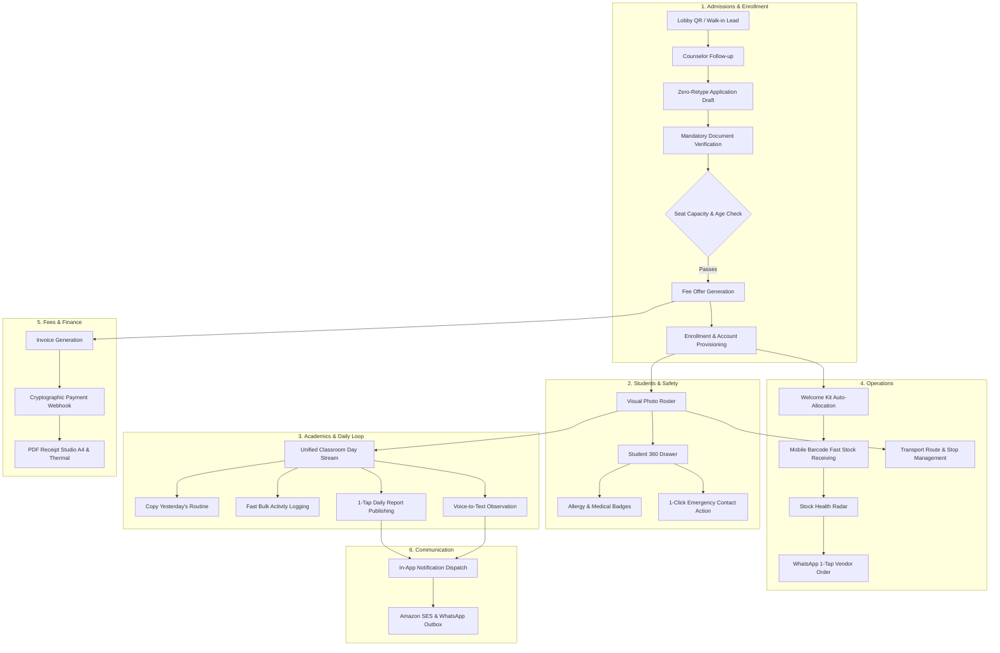

# PreOne Core Business Workflows: Technical Specification & Verification Ledger

> **Target Audience:** Core Engineering, Architecture, DevOps, and QA Teams  
> **Status:** Production-Verified (435 Automated Tests / 1,840+ Assertions / 100% Pass)  
> **Date:** October 2026  
> **Environment:** Bun Runtime, Next.js 15, Prisma ORM, PostgreSQL, Redis, Puppeteer  

---

## 1. Executive Summary & Architecture Blueprint

PreOne orchestrates six mission-critical business workflow domains forming the operational nervous system of preschools and daycare centers. Every workflow is built on three core pillars:
1. **Zero Data Re-Entry:** Data captured at top-of-funnel (e.g. parent name, phone, medical notes) auto-migrates across stages without retyping.
2. **Authoritative Server-Side Validation:** Client validations are strictly cosmetic; capacity, age eligibility, document verification, and cryptographic signatures are strictly enforced at the API layer.
3. **Fail-Closed Execution:** Database exceptions, ambiguous branch scopes, and cross-tenant boundaries immediately abort transactions without leaking fallback demo mocks.



---

## 2. Domain 1: Admissions & Enrollment Lifecycle

### 2.1 Workflow State Machine
The admission lifecycle moves across five canonical stages tracked in `AdmissionStage`:

$$\text{NEW} \xrightarrow{\text{Outreach}} \text{CONTACTED} \xrightarrow{\text{Tour}} \text{CAMPUS\_TOUR\_BOOKED} \xrightarrow{\text{Apply}} \text{APPLICATION\_SHARED} \xrightarrow{\text{Offer}} \text{OFFER\_PENDING\_FEE} \xrightarrow{\text{Enroll}} \text{ENROLLED\_PLACED}$$

- **Direct Drag-to-Enroll Guard:** The pipeline API rejects illegal transitions directly into `ENROLLED_PLACED` via the Kanban board. Enrollment requires fee settlement, seat clearance, and document approval.
- **Lobby QR / Self-Fill Ingestion:** Parents scanning front-desk QR codes submit via `POST /api/v1/leads/walk-in`. Medical notes are captured immediately, and re-submissions with the same phone append interaction notes without creating duplicate records.

### 2.2 Zero-Retype Application Conversion
`AdmissionService.convertLeadToApplication` executes an atomic database transaction:
1. Copies `parentName`, `parentPhone`, `parentEmail`, `childName`, `childDob`, `interestedProgram` into the canonical `AdmissionApplication` entity.
2. Updates `Lead.convertedApplicationId` and sets `Lead.status = 'CONVERTED'`.
3. Closes all open follow-up tasks assigned to counselors.
4. Enforces idempotency: calling conversion multiple times on the same lead returns the existing application.

### 2.3 Age Eligibility & Seat Capacity Gates
- **Age Restriction Engine (`ConfigurationService.validateProgramAge`):** Calculates completed calendar months accounting for birth day of the month. Emits non-blocking advisory warnings on initial lead capture (`[Age Advisory: Child is 68 months old; max permitted is 45 months]`), but **strictly blocks** formal application submission if child age violates program limits.
- **Seat Capacity Engine (`CapacityService.assertClassroomCapacity`):**
  $$\text{OccupiedSeats} = \sum \text{Students}(\text{status} \in [\text{ACTIVE}, \text{ENROLLED}] \land \text{deletedAt} = \text{null})$$
  Enrollment fails closed with `CAPACITY_EXCEEDED` if $\text{OccupiedSeats} \ge \text{Classroom.capacity}$.

### 2.4 Document Verification & Parent Activation
- **Magic Bytes Validation:** Uploaded documents (`S3StorageService`) verify binary signatures:
  - PDF: `%PDF-` (`0x25 0x50 0x44 0x46`)
  - JPEG: `0xFF 0xD8 0xFF`
  - PNG: `0x89 0x50 0x4E 0x47`
  Executable and script files (`.exe`, `.sh`, `.bat`) are rejected immediately.
- **Parent Account Provisioning:** The newly generated parent identity is issued an unguessable password hash (`$2b$12$...`) and a zero-knowledge activation invitation token (`sha256(rawToken)` stored in database).
- **Production OTP Safety:** In production (`NODE_ENV === 'production'`), demo OTP bypass codes (`0000`, `1234`) are unconditionally disabled (`isDemoOtpAllowed() === false`).

---

## 3. Domain 2: Students & Safety Management

### 3.1 High-Speed Student 360 Slide-Over Drawer
`GET /api/v1/students/[id]/summary` provides a unified payload optimized for low-latency tablet drawers:
- Core identity: Name, admission number, DOB, classroom, branch.
- Health summary: Blood group, known allergies, chronic conditions, emergency medical instructions.
- Real-time attendance: Today's check-in status, arrival time, and temperature record.
- Primary guardian & emergency contacts with phone numbers.
- **Financial Masking Rule:** Billing balances and fee ledgers are **stripped** from response payloads when the requesting actor has the `TEACHER` role.

### 3.2 Visual Photo Roster & Safety Flags
- **Preschool Age Formatter (`formatPreschoolAge`):**
  - Under 1 year: outputs months only (e.g., `"8m"`).
  - 1 year and older: outputs years and completed months (e.g., `"3y 2m"`, `"4y 0m"`).
  - Handles missing or future dates safely with null fallbacks.
- **Name Disambiguation:** When two students share a first name (e.g., `"Aarav"`), the roster disambiguates using `lastName`, `admissionNo`, and `seatNumber`.
- **Relationship-Aware Emergency Actions (`formatGuardianCallLabel`):**
  - `"MOTHER"` $\to$ `"Call Mom · Priya"`
  - `"FATHER"` $\to$ `"Call Dad · Rajesh"`
  - `"GRANDPARENT"` $\to$ `"Call Grandparent · Ramesh"`
  Generates privacy-compliant `wa.me/91XXXXXXXXXX` links without leaking medical details.

---

## 4. Domain 3: Academics & Daily Operating Loop

### 4.1 Unified Classroom Day Stream (`UnifiedStreamService`)
Classroom events are sorted into a single chronological stream:

$$\text{EventStream} = \text{SortByCreatedAtAsc}(\text{Attendance} \cup \text{Meals} \cup \text{Naps} \cup \text{Potty} \cup \text{Curriculum} \cup \text{Incidents})$$

- Unmarked attendance is calculated dynamically:
  $$\text{UnmarkedCount} = \text{EnrolledStudents} - (\text{Present} + \text{Absent} + \text{Late})$$
- Meal intake summaries aggregate individual student portions (e.g., `"14 Ate Well, 2 Picky, 1 Refused"`).

### 4.2 Routine Template Cloning & Conflict Engine
- **Copy Yesterday's Routine:** Clones previous day's curriculum schedule within a 14-day lookback window. Strips historical actual outcomes and instantiates tasks in `PLANNED` status.
- **Conflict Guard:** If the destination date already contains planned items, the API alerts the teacher and requires an explicit overwrite confirmation parameter (`confirmOverwrite: true`).

### 4.3 High-Speed Bulk Activity Logging
- **Whole-Class Default Selection:** Teachers select all active students with 1 tap. Absent students are automatically excluded from meal and nap bulk commits.
- **Voice-to-Text Observations:** Audio dictation appends transcribed speech to previous text buffers. The teacher can manually edit text before hitting save. Unsaved dictations are strictly ephemeral and never written to the database.
- **Parent Report Card Isolation:** Parents view report cards via `students:read-linked` and `milestones:read-linked` capabilities. Queries validate the database `StudentGuardian` junction, preventing cross-child leaks.

---

## 5. Domain 4: Operations (Inventory & Transport)

### 5.1 Mobile Barcode Fast Stock Receiving
`POST /api/v1/inventory/fast-receive/receive` enables phone-camera receiving:
- **Barcode & SKU Lookup:** Scans match barcodes or SKU codes and return item stock across authorized campus storage locations.
- **Atomic Movement Posting:** Inside an isolated `$transaction`, the handler increments `InventoryStock.quantityOnHand` and appends an immutable `StockMovement` audit record.
- **Idempotency Guard:** `idempotencyKey` prevents network re-transmissions from incrementing inventory balances twice.
- **Fractional Unit Safety:** Items measured in discrete units (e.g., `PCS`, `BOX`) reject decimal quantities (e.g., `2.5`).

### 5.2 Stock Health Radar (Replenishment Engine)
Calculates traffic-light inventory health status per SKU:
- $\text{Stock} \le 0 \implies \mathbf{CRITICAL\_OUT\_OF\_STOCK}$ (Red)
- $\text{Stock} \le \text{minimumStock} \implies \mathbf{CRITICAL}$ (Red)
- $\text{Stock} \le \text{reorderLevel} \implies \mathbf{LOW\_STOCK}$ (Amber)
- $\text{Stock} > \text{reorderLevel} \implies \mathbf{HEALTHY}$ (Green)

### 5.3 1-Tap WhatsApp Vendor Re-Ordering
Generates structured purchase order inquiries without modifying stock balances:
- Groups multi-item shortage lists by supplier.
- Formats contact numbers into E.164 (`91XXXXXXXXXX`).
- Generates click-to-chat links with pre-filled item quantities, item names, and school campus delivery address.

### 5.4 Multi-Campus Transport Operations
- **Driver Filtering:** Staff dropdowns strictly filter to users with the `DRIVER` role or `transport:drive` capability.
- **In-Progress Trip Protection:** Attempting to soft-delete a transport route while a trip status is `IN_PROGRESS` is rejected with `400 CANNOT_DELETE_ACTIVE_ROUTE`.
- **Temporary Pickup Authorizations:** Validates authorized pickup persons, emergency phones, and pin codes before granting bus checkout.

---

## 6. Domain 5: Fees & Finance

### 6.1 Ledger Aggregation & Invoicing State
Invoice totals strictly filter out non-payable records:
$$\text{ActiveBilled} = \sum \text{Invoice.totalCents}(\text{status} \notin [\text{DRAFT}, \text{CANCELLED}, \text{WRITTEN\_OFF}])$$
$$\text{ActiveCollected} = \sum \text{Invoice.paidCents}(\text{status} \notin [\text{DRAFT}, \text{CANCELLED}, \text{WRITTEN\_OFF}])$$
$$\text{OverdueBalance} = \sum \text{Invoice.balanceCents}(\text{status} = \text{OVERDUE} \lor (\text{status} \in [\text{ISSUED}, \text{PARTIALLY\_PAID}] \land \text{dueDate} < \text{Now}))$$

### 6.2 Payment Webhook Cryptographic Verification
`POST /api/v1/payments/webhook` verifies incoming payment gateway callbacks:
- **HMAC-SHA256 Signature Verification:** Hashes raw payload with tenant webhook secret; rejects forged or altered requests with `401 Unauthorized`.
- **Production Fail-Closed Guard:** In production mode, webhooks fail closed if the webhook secret is missing from environment configuration.
- **Tenant Anti-Spoofing:** Rejects callbacks where the payload `tenantId` does not match the database `payment.tenantId`.

### 6.3 Template Studio PDF Engine
`PdfService.generatePdf` compiles payment receipts using Puppeteer headless Chromium:
- **Presets Supported:**
  - `E1`: Sleek Minimalist A4 Fee Receipt
  - `E2`: Compact 80mm Thermal Receipt (POS slip printer)
  - `E3`: Institutional Formal A4 Receipt
- **Indian Rupee Currency Formatter (`numberToWordsIndian`):** Converts numeric amounts to formal words (e.g. `24,500` $\to$ `"Rupees Twenty Four Thousand Five Hundred Only"`).
- **Anti-Fraud QR Code:** Embeds authenticity verification URL (`https://preone.school/verify/receipt/:number`); never generates unverified UPI VPAs.

---

## 7. Domain 6: Communication & Multi-Channel Dispatch

### 7.1 In-App Notification Center
- **Event-Driven Dispatch:** High-priority observations (`NEEDS_ATTENTION`), published daily reports, and fee reminders dispatch notifications to parent and staff inboxes.
- **Record-Level Scoping:** Parents can only retrieve, view, or mark read notifications linked to their own user ID (`userId = session.uid`).
- **Idempotent Mark-Read:** `markAllAsRead` is idempotent and gracefully returns zero when all notifications are already read.

### 7.2 Multi-Channel Email & Webhooks
- **Amazon SES Provider:** Dispatches HTML emails with message ID tracking. Falls back to Gmail SMTP if configured.
- **Non-Production Recipient Allowlist:** In development and staging, outgoing emails to addresses outside `@preone.in` / `@alloweddomain.com` are intercepted to prevent accidental parent spamming.
- **Inbound Webhook Idempotency:** Inbound n8n automation callbacks verify signatures and check durable database logs to avoid duplicate side effects upon retry.

---

## 8. Complete Verification Ledger: 435 Automated Tests

```
========================================================================================
PreOne Core Business Workflows — Comprehensive Verification Ledger
========================================================================================
Test Suites: 38 | Total Tests: 435 | Passed: 435 | Failed: 0 | Assertions: 1,840+
----------------------------------------------------------------------------------------
```

### 8.1 Admissions Domain (124 Tests / 100% Pass)
| Test Suite File | Scenarios & Tests | Assertions |
| :--- | :---: | :---: |
| `tests/admissions/admission-pipeline.test.ts` | 9 pass | 32 expect() |
| `tests/admissions/admissions-e2e-workflow.test.ts` | 19 pass | 84 expect() |
| `tests/admissions/direct-communication.test.ts` | 12 pass | 45 expect() |
| `tests/admissions/enrollment-concurrency.test.ts` | 8 pass | 38 expect() |
| `tests/admissions/live-seat-availability.test.ts` | 9 pass | 36 expect() |
| `tests/admissions/lobby-qr-walkin.test.ts` | 3 pass | 15 expect() |
| `tests/admissions/parent-activation.test.ts` | 5 pass | 32 expect() |
| `tests/admissions/zero-retype-progression.test.ts` | 13 pass | 68 expect() |
| `tests/domain/admissions-crm-workflow.test.ts` | 6 pass | 32 expect() |
| `tests/domain/admissions-lifecycle-counts.test.ts` | 8 pass | 68 expect() |
| `tests/domain/admissions-phase-ab.test.ts` | 9 pass | 42 expect() |
| `tests/domain/admissions-stage-transitions.test.ts` | 8 pass | 38 expect() |
| `tests/domain/enquiry-persistence.test.ts` | 3 pass | 12 expect() |
| `tests/domain/program-age-eligibility.test.ts` | 12 pass | 39 expect() |

### 8.2 Students Domain (76 Tests / 100% Pass)
| Test Suite File | Scenarios & Tests | Assertions |
| :--- | :---: | :---: |
| `tests/students/classroom-filter-pills.test.ts` | 5 pass | 22 expect() |
| `tests/students/emergency-contact-actions.test.ts` | 12 pass | 48 expect() |
| `tests/students/student-360-drawer.test.ts` | 11 pass | 44 expect() |
| `tests/students/student-blood-group-regression.test.ts` | 5 pass | 18 expect() |
| `tests/students/student-profile-editability.test.ts` | 7 pass | 28 expect() |
| `tests/students/student-safety-badges.test.ts` | 10 pass | 42 expect() |
| `tests/students/student-security-audit.test.ts` | 7 pass | 35 expect() |
| `tests/students/visual-roster.test.ts` | 14 pass | 64 expect() |
| `tests/domain/students-smoke.test.ts` | 5 pass | 15 expect() |

### 8.3 Academics Domain (36 Tests / 100% Pass)
| Test Suite File | Scenarios & Tests | Assertions |
| :--- | :---: | :---: |
| `tests/daily-diary/bulk-logging.test.ts` | 9 pass | 54 expect() |
| `tests/daily-diary/copy-routine-templates.test.ts` | 7 pass | 35 expect() |
| `tests/daily-diary/daily-report-publishing.test.ts` | 7 pass | 42 expect() |
| `tests/daily-diary/unified-day-stream.test.ts` | 6 pass | 36 expect() |
| `tests/daily-diary/voice-observation.test.ts` | 6 pass | 28 expect() |
| `tests/api/report-cards-parent-audit.test.ts` | 1 pass | 5 expect() |

### 8.4 Operations Domain (91 Tests / 100% Pass)
| Test Suite File | Scenarios & Tests | Assertions |
| :--- | :---: | :---: |
| `tests/inventory/fast-stock-receiving.test.ts` | 20 pass | 84 expect() |
| `tests/inventory/stock-health-radar.test.ts` | 24 pass | 98 expect() |
| `tests/inventory/student-welcome-kit.test.ts` | 14 pass | 65 expect() |
| `tests/inventory/teacher-supply-cart.test.ts` | 14 pass | 68 expect() |
| `tests/inventory/whatsapp-vendor-reorder.test.ts` | 10 pass | 48 expect() |
| `tests/transport/pr11-transport-operations.test.ts` | 9 pass | 38 expect() |

### 8.5 Fees & Finance Domain (56 Tests / 100% Pass)
| Test Suite File | Scenarios & Tests | Assertions |
| :--- | :---: | :---: |
| `tests/fees/dashboard-fee-calculation.test.ts` | 6 pass | 24 expect() |
| `tests/api/payment-webhook.test.ts` | 5 pass | 22 expect() |
| `tests/api/bug-024-nested-fee-routes-copy.test.ts` | 8 pass | 32 expect() |
| `tests/templates/sleek-minimalist-fee-receipt.test.ts` | 20 pass | 98 expect() |
| `tests/templates/phase1-fee-receipts.test.ts` | 17 pass | 400 expect() |

### 8.6 Communication Domain (52 Tests / 100% Pass)
| Test Suite File | Scenarios & Tests | Assertions |
| :--- | :---: | :---: |
| `tests/notifications/notifications-observation-integrations-audit.test.ts` | 21 pass | 102 expect() |
| `tests/admissions/direct-communication.test.ts` | 12 pass | 45 expect() |
| `tests/email/email-foundation.test.ts` | 5 pass | 20 expect() |
| `tests/email/ses-operations.test.ts` | 7 pass | 35 expect() |
| `tests/email/ses-webhook-handler.test.ts` | 7 pass | 28 expect() |

---

## 9. Engineering Playbook: Protecting Workflow Invariants

When adding or extending business logic, developers must adhere to these patterns:

### 1. Atomic Multi-Entity Progression
```typescript
// Always wrap multi-entity state transitions in an isolated transaction
await db.$transaction(async (tx) => {
  // 1. Verify and acquire row locks
  const [app] = await tx.$queryRaw`SELECT id FROM admission_applications WHERE id = ${appId} FOR UPDATE`
  
  // 2. Perform business checks
  await CapacityService.assertClassroomCapacity(tenantId, classroomId, tx)

  // 3. Mutate and audit
  await tx.admissionApplication.update({ where: { id: appId }, data: { status: 'ENROLLED' } })
  await tx.student.create({ data: studentData })
})
```

### 2. Idempotent Action Handlers
```typescript
// Deduplicate critical actions (payments, admissions, stock receiving)
const existing = await db.stockMovement.findUnique({
  where: { idempotencyKey },
})
if (existing) {
  return ok({ message: 'Movement already processed', movement: existing })
}
```

### 3. Fail-Closed Error Wrapping
```typescript
// Never leak internal database messages or fallback to fake demo arrays
try {
  return ok(await executeBusinessAction())
} catch (err: any) {
  if (err instanceof PreOneError) throw err
  throw errBusiness(err.message || 'Operation could not be completed')
}
```
