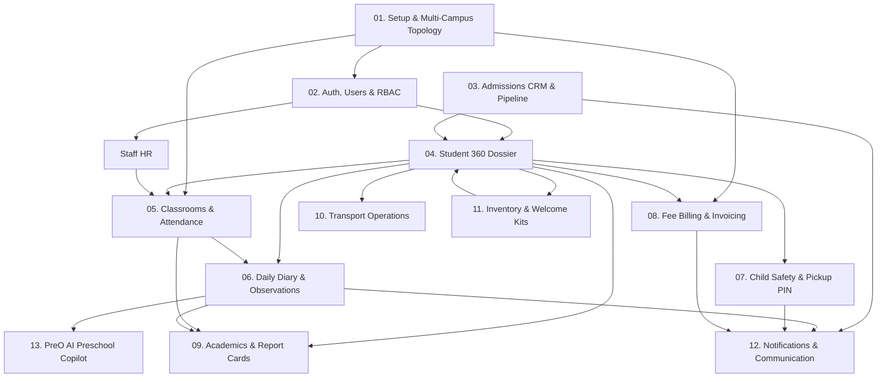
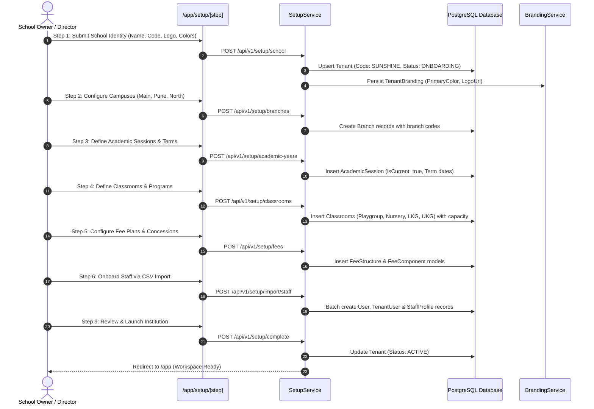
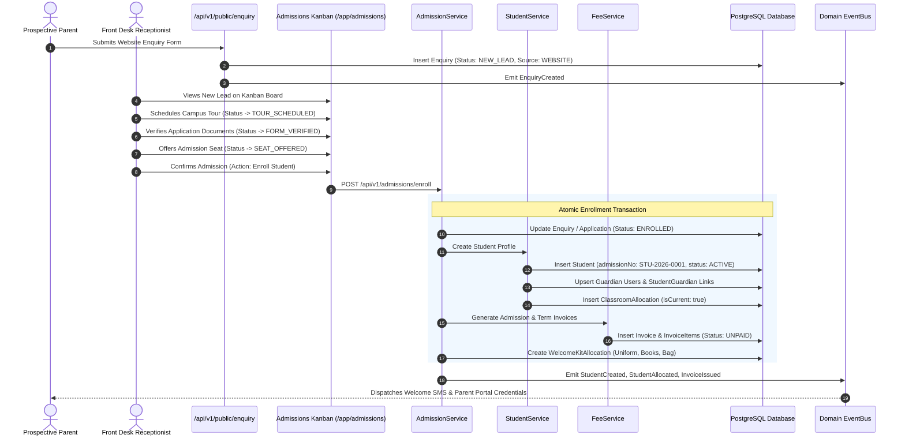
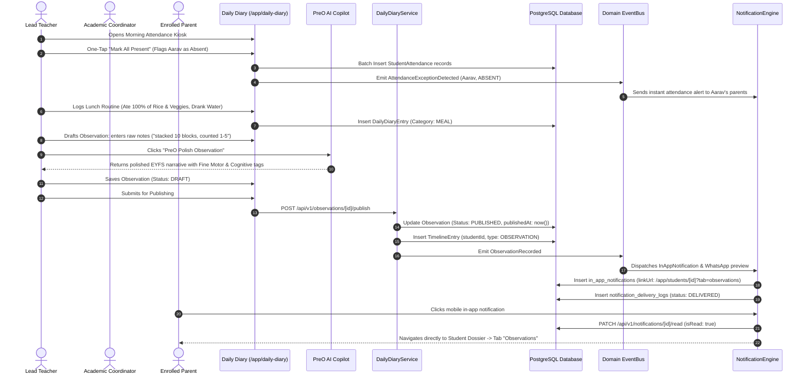
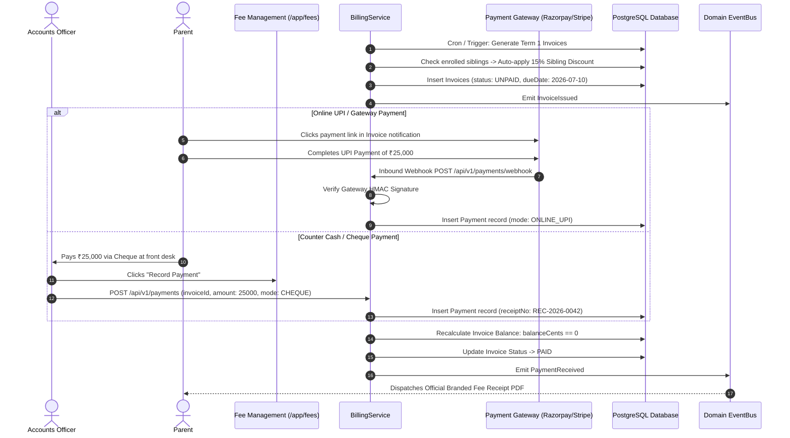
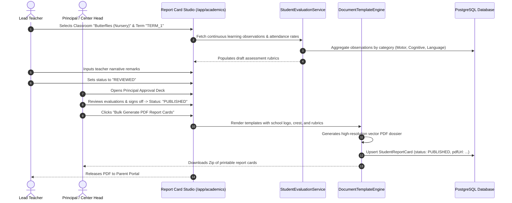
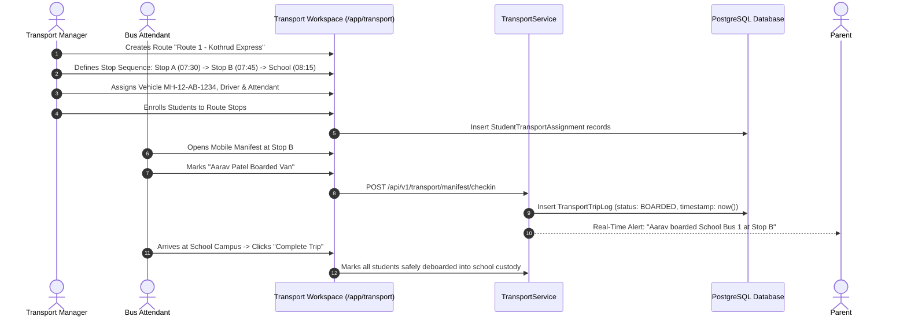
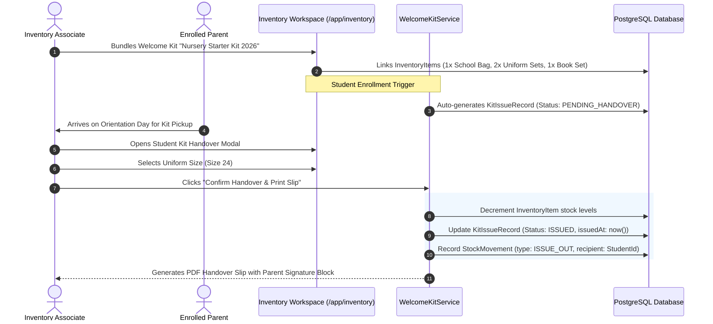
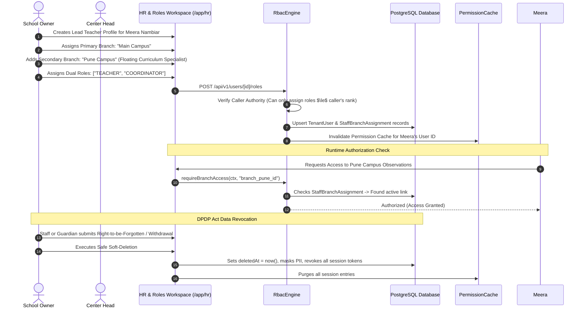

# PreOne: Module-to-Module Dependencies & End-to-End Business Logic Flows

**Document Version:** 1.0 (Production Architecture Specification)  
**System:** PreOne Preschool & Early Childhood Operating System  
**Framework:** Next.js 16.3 (App Router), TypeScript 5.7, Prisma ORM 6.11, PostgreSQL 16  
**Audience:** Principal Architects, Staff Full-Stack Engineers, Product Managers, Solution Leads  
**Repository Working Copy:** `c:\Users\Nuke\Documents\GitHub\pre-one`  

---

## Table of Contents
1. [High-Level Architectural Topology & Dependency Matrix](#1-high-level-architectural-topology--dependency-matrix)
2. [Module Inter-Dependency Map](#2-module-inter-dependency-map)
3. [Domain Event Dispatcher & Cross-Module Messaging](#3-domain-event-dispatcher--cross-module-messaging)
4. [End-to-End Flow 1: School Onboarding & Franchise Multi-Campus Setup](#4-end-to-end-flow-1-school-onboarding--franchise-multi-campus-setup)
5. [End-to-End Flow 2: Inquiries, Admissions & Automated Student Lifecycle](#5-end-to-end-flow-2-inquiries-admissions--automated-student-lifecycle)
6. [End-to-End Flow 3: Classroom Care, Attendance & AI-Powered Observations](#6-end-to-end-flow-3-classroom-care-attendance--ai-powered-observations)
7. [End-to-End Flow 4: Bulletproof Child Safety, Gate Dismissal & PIN Handover](#7-end-to-end-flow-4-bulletproof-child-safety-gate-dismissal--pin-handover)
8. [End-to-End Flow 5: Billing, Concessions, Invoicing & Financial Settlement](#8-end-to-end-flow-5-billing-concessions-invoicing--financial-settlement)
9. [End-to-End Flow 6: Academic Evaluation, Rubrics & Branded Report Card Studio](#9-end-to-end-flow-6-academic-evaluation-rubrics--branded-report-card-studio)
10. [End-to-End Flow 7: Transport Operations & Fleet Roster Manifest](#10-end-to-end-flow-7-transport-operations--fleet-roster-manifest)
11. [End-to-End Flow 8: Uniforms, Books & Preschool Welcome Kit Inventory](#11-end-to-end-flow-8-uniforms-books--preschool-welcome-kit-inventory)
12. [End-to-End Flow 9: Staff Lifecycle, Multi-Branch Floating RBAC & DPDP Compliance](#12-end-to-end-flow-9-staff-lifecycle-multi-branch-floating-rbac--dpdp-compliance)

---

# 1. High-Level Architectural Topology & Dependency Matrix

PreOne is built as a modular monolith adhering to Domain-Driven Design (DDD). Business domains communicate synchronously through strongly-typed Service boundaries (`src/lib/*`), and asynchronously through an in-process, non-blocking Domain Event Dispatcher (`src/lib/events.ts`).

```
┌─────────────────────────────────────────────────────────────────────────────┐
│                       PRESENTATION LAYER (Next.js 16)                       │
│  SSR Server Components  │  Client Interactive Trees  │  Global Workspace    │
└──────────────────────────────────────┬──────────────────────────────────────┘
                                       │ HTTP / Session Cookies
┌──────────────────────────────────────▼──────────────────────────────────────┐
│                    API ROUTE HANDLERS (/api/v1/*)                          │
│  withApi Wrapper │ Session Validation │ RBAC Authorization │ Input Validation │
└──────────────────────────────────────┬──────────────────────────────────────┘
                                       │ Pure Types & Method Calls
┌──────────────────────────────────────▼──────────────────────────────────────┐
│                          DOMAIN SERVICE LAYER                               │
│  StudentService  │ AdmissionService │ FeeService │ DailyDiaryService         │
│  TransportService│ WelcomeKitService│ ReportService│ NotificationEngine       │
└──────────────┬───────────────────────────────────────────────┬──────────────┘
               │ Emits Domain Events                           │ Prisma Queries
┌──────────────▼──────────────┐                ┌──────────────▼──────────────┐
│   DOMAIN EVENT DISPATCHER   │                │     PERSISTENCE LAYER       │
│      (src/lib/events.ts)    │                │      PostgreSQL 16 Engine    │
│  In-process, non-blocking   │                │  Row-Level Tenant Isolation │
│  Fire-and-forget consumers  │                │  Multi-Tenant Foreign Keys   │
└─────────────────────────────┘                └─────────────────────────────┘
```

---

# 2. Module Inter-Dependency Map

The core functional modules within PreOne exhibit the following dependency graph:



### Dependency Rules & Boundaries:
1. **The Tenant Root Invariant:** Every domain entity references `tenantId` directly or via an immutable parent relationship.
2. **The Student Master Invariant:** `Student` serves as the primary aggregate root for all child-related subsystems: Attendance, Diary, Observations, Safety PINs, Invoices, Transport, and Welcome Kits.
3. **Fail-Closed Branch Quarantine:** Staff without multi-branch authorization cannot access student, invoice, or attendance records outside their assigned `branchId`.
4. **Parent Quarantine:** Parents (`role: PARENT`) are strictly bounded to students connected via `StudentGuardian` records where `receivesComm: true` and `deletedAt: null`.

---

# 3. Domain Event Dispatcher & Cross-Module Messaging

Cross-module side effects execute asynchronously through `emit(event)` in `src/lib/events.ts`. This design decouples core write transactions from notifications, audit trails, and integrations.

| Event Type | Producer Module | Consumer Handlers & Side Effects |
|---|---|---|
| `StudentCreated` | Admissions / Student Service | Allocates student ID; pre-populates Welcome Kit record; initializes attendance ledger. |
| `StudentAllocated` | Classroom Service | Updates student classroom history; adjusts classroom occupancy KPI. |
| `AttendanceExceptionDetected` | Attendance Kiosk | Dispatches `ATTENDANCE_UPDATE` notification to parents (Absent/Late alerts). |
| `ObservationRecorded` | Daily Diary / PreO AI | Dispatches `OBSERVATION_PUBLISHED` in-app notification to child guardians; creates timeline entry. |
| `HealthIncidentCreated` | Student Safety Module | Flags student medical profile; dispatches urgent `HEALTH_ALERT` to parents & center leadership. |
| `PickupBlocked` | Security Gate Panel | Logs unauthorized pickup attempt; triggers emergency staff push notification. |
| `InvoiceIssued` | Fee & Billing Engine | Generates payment gateway link; dispatches `FEE_DUE` in-app & WhatsApp alert. |
| `PaymentReceived` | Payment Webhook / Cashier | Emits `PaymentReceived`; marks invoice status; issues sequential branded PDF receipt. |
| `StockBelowReorderLevel` | Inventory Module | Notifies Center Head & Operations Associate for procurement replenishment. |
| `N8nIntegrationEvent` | External Webhook Engine | Dispatches event to n8n webhook runner with HMAC-SHA256 signature verification. |

---

# 4. End-to-End Flow 1: School Onboarding & Franchise Multi-Campus Setup

The foundational configuration lifecycle establishes institutional identity, campus topology, and fiscal boundaries.



### Key Business Invariants & Logic:
1. **Tenant Code Immutability:** Tenant code (e.g. `SUNSHINE`) is alphanumeric, uppercase, unique across the platform, and used for login domain resolution.
2. **Main Branch Requirement:** Exactly one branch must have `isMain: true` per tenant.
3. **Session Overlap Protection:** Academic sessions within a single tenant cannot have overlapping active date ranges.
4. **CSV Pre-Flight Validation:** Staff import verifies duplicate emails, invalid phone numbers, and unrecognized roles before committing transactions.

---

# 5. End-to-End Flow 2: Inquiries, Admissions & Automated Student Lifecycle

This workflow represents the preschool revenue engine, taking prospective parents from public inquiry to formal enrollment with zero duplicate data entry.



### Key Business Invariants & Logic:
1. **Age-Program Matcher:** System compares child DOB against academic session cut-off date:
   - $1.5 \le \text{Age} < 2.5 \text{ years} \implies \text{Playgroup}$
   - $2.5 \le \text{Age} < 3.5 \text{ years} \implies \text{Nursery}$
   - $3.5 \le \text{Age} < 4.5 \text{ years} \implies \text{LKG / Junior KG}$
   - $4.5 \le \text{Age} < 6.0 \text{ years} \implies \text{UKG / Senior KG}$
2. **Automatic Sibling Detection:** If the parent email or phone matches an existing guardian with an enrolled sibling, a sibling concession flag (`siblingDiscount: true`) is linked to the fee ledger.
3. **No Phantom Accounts:** Public enquiries do *not* create user accounts until the formal `ENROLLED` stage is executed.

---

# 6. End-to-End Flow 3: Classroom Care, Attendance & AI-Powered Observations

This workflow drives daily parent retention and showcases the synergy between routine tracking and PreO AI.



### Key Business Invariants & Logic:
1. **Draft-Publish Gate:** Observations recorded with `concern: NEEDS_ATTENTION` or `URGENT` notify the Academic Coordinator for internal review before being released to parents.
2. **Student-Scoped URL Routing:** In-app notification links embed query parameter `?tab=observations`. The UI server component reads `searchParams` on SSR, activating the developmental observation tab immediately.
3. **Idempotent Delivery:** Re-publishing an already published observation fails with `409 Conflict` to prevent duplicate parent spam.

---

# 7. End-to-End Flow 4: Bulletproof Child Safety, Gate Dismissal & PIN Handover

Designed for 12:30 PM gate rush security, preventing unauthorized child release through cryptographic PIN verification.

```mermaid
sequenceDiagram
    autonumber
    actor Guardian as Guardian / Driver
    actor GateStaff as Security / Attendant
    participant GateUI as Student Safety Panel (/app/students/[id])
    participant AuthSvc as SafetyVerificationService
    participant DB as PostgreSQL Database
    participant Bus as Domain EventBus
    actor Parent as Primary Parent (Mother)

    Guardian->>GateStaff: Arrives at Gate: "Here to pick up Aarav Patel"
    GateStaff->>GateUI: Searches "Aarav" (Ctrl + K) -> Opens Safety Panel
    GateUI->>DB: Fetches Authorized Pickup Allowlist & Guardian Photos
    
    alt Guardian is NOT in Allowlist
        GateStaff-->>Guardian: Access Denied (Flagged Red: UNAUTHORIZED CONTACT)
        GateStaff->>DB: Log GateIncident (Status: BLOCKED)
        GateStaff->>Bus: Emit PickupBlocked
        Bus-->>Parent: Urgent Alert: "Unrecognized person attempted pickup"
    else Guardian IS in Allowlist
        GateStaff->>GateUI: Requests 4-Digit Pickup PIN
        Guardian->>GateStaff: Enters PIN: "1234"
        GateUI->>AuthSvc: POST /api/v1/students/[id]/verify-pickup
        AuthSvc->>DB: Fetches stored bcrypt hash from Guardian record
        AuthSvc->>AuthSvc: bcrypt.compare("1234", storedHash)
        
        alt PIN Mismatch
            AuthSvc-->>GateUI: Invalid PIN (Warning Toast & Shake Animation)
            GateUI->>DB: Record FailedAttempt (Increment counter)
        else PIN Valid Match
            AuthSvc-->>GateUI: HTTP 200: VALID MATCH (Green Shield Badge)
            GateStaff->>GateUI: Confirms Release
            GateUI->>DB: Insert StudentDismissalLog (guardianId, staffId, timestamp)
            GateUI->>Bus: Emit ChildReleased
            Bus-->>Parent: Push Notification: "Aarav safely picked up by Father at 12:34 PM"
        end
    end
```



### Key Business Invariants & Logic:
1. **Separation of Emergency Contacts vs. Pickup Contacts:** A contact may be listed for medical emergencies (`isEmergency: true`) without having child pickup authorization (`authorizedPickup: false`).
2. **Cryptographic Hashing:** Guardian pickup PINs are never stored in plaintext. They are salted and hashed using `bcrypt` (10 rounds).
3. **Audit Trail Persistence:** Every gate release creates an immutable `StudentDismissalLog` capturing the timestamp, staff ID, guardian ID, and pickup mode (Walk-in, School Van, Private Car).

---

# 8. End-to-End Flow 5: Billing, Concessions, Invoicing & Financial Settlement

The financial lifecycle guarantees zero fee leakage across multiple preschool campuses.



### Key Business Invariants & Logic:
1. **Invoice State Machine:**
   $$\text{DRAFT} \longrightarrow \text{UNPAID} \longrightarrow \text{PARTIAL} \longrightarrow \text{PAID}$$
   $$\text{UNPAID / PARTIAL} \xrightarrow{\text{Past Due Date}} \text{OVERDUE}$$
2. **Sequential Receipt Integrity:** Receipt numbers are generated sequentially per tenant (`REC-YYYY-XXXXX`) and cannot be deleted or re-used.
3. **Webhook Replay Protection:** Inbound payment webhooks verify transaction ID idempotency before applying ledger mutations.

---

# 9. End-to-End Flow 6: Academic Evaluation, Rubrics & Branded Report Card Studio

The preschool evaluation pipeline aggregates continuous developmental data into professional, branded report card PDFs.



### Key Business Invariants & Logic:
1. **Non-Numeric Evaluation Rubrics:** Preschool assessments map to qualitative scales (*Emerging, Developing, Proficient, Mastered*) rather than letter grades or marks.
2. **Template Versioning:** Every generated report card snapshot binds the exact `templateVersion` used at generation time to preserve archival fidelity.

---

# 10. End-to-End Flow 7: Transport Operations & Fleet Roster Manifest

Covers safe student transportation, stop sequences, and mobile attendant manifest verification.



### Key Business Invariants & Logic:
1. **Capacity Enforcement:** A transport vehicle cannot be assigned more students than its licensed physical seating capacity.
2. **Trip Safety Verification:** Trip completion cannot be marked if any assigned child remains unaccounted for on the manifest.

---

# 11. End-to-End Flow 8: Uniforms, Books & Preschool Welcome Kit Inventory

Prevents stock shrinkage and guarantees smooth Day-1 student onboarding.



### Key Business Invariants & Logic:
1. **Stock Lock:** A Welcome Kit cannot be marked as issued if any bundled item has insufficient inventory in the campus store.
2. **Reorder Threshold Alarm:** When quantity drops below `reorderLevel`, the domain dispatcher emits `StockBelowReorderLevel` alerting the Center Head.

---

# 12. End-to-End Flow 9: Staff Lifecycle, Multi-Branch Floating RBAC & DPDP Compliance

Maintains strict separation of duties, dynamic permissions, and privacy compliance.



### Key Business Invariants & Logic:
1. **Hierarchical Privilege Escalation Prevention:**
   $$\text{OWNER} > \text{PRINCIPAL} > \text{COORDINATOR} > \text{TEACHER} / \text{ACCOUNTS} > \text{STAFF} > \text{PARENT}$$
   A user can never assign or elevate a role equal to or higher than their own hierarchy level.
2. **Immediate Cache Eviction:** Any role mutation, branch assignment change, or user suspension immediately invalidates the Redis/in-memory session permission cache (`Cache.del`).
3. **Fail-Closed Default:** If an actor's branch assignments cannot be resolved, all branch-scoped data endpoints fail closed with `403 Forbidden`.

---
*End of Complete Business & Logic Flow Document — PreOne Enterprise Architecture Team*
