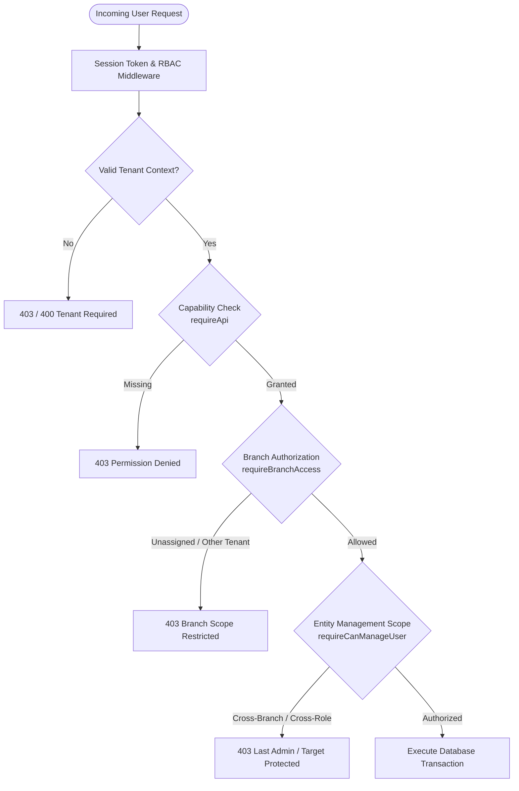
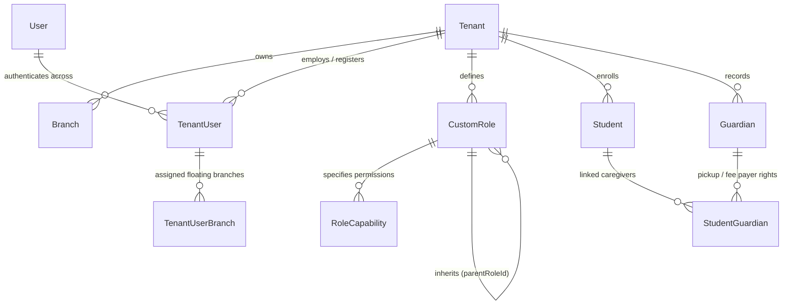
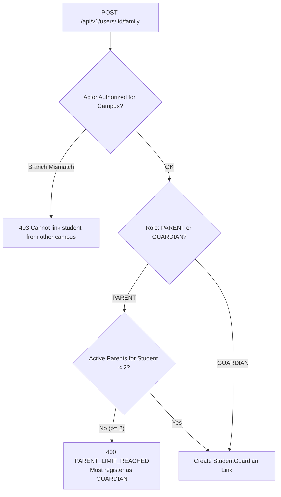

# PreOne RBAC, Access Control & Branch Isolation Technical Specification

> **Audience:** Engineering, DevOps, QA, and Security Teams  
> **Status:** Production-Verified & Automated Test-Backed (95 Passing Tests / 269 Assertions)  
> **Version:** 2.4.0 (Post-Audit Remediation)  
> **Date:** October 2026  

---

## 1. Executive Summary & Security Objectives

PreOne operates as a multi-tenant, multi-branch Preschool and Daycare Management Operating System. It provides school owners, campus administrators, educators, accountants, and parents with distinct access levels while enforcing hard boundaries:

1. **Strict Multi-Tenancy (Zero Cross-Tenant Leakage):** Under no circumstance may any actor (including an `OWNER`) query, mutate, or infer records belonging to another school tenant.
2. **Deterministic Campus Scoping:** Campus heads (Principals) and operational staff assigned to a specific branch cannot access or manipulate student, inventory, classroom, or financial data belonging to other branches.
3. **Privilege Escalation Immunity:** Non-owners cannot assign the `OWNER` role, school-level actors cannot assign `PLATFORM_ADMIN`, and actors cannot elevate their own permissions or bypass branch scoping.
4. **Resilient Family & Caregiver Boundaries:** Parents and legal guardians are strictly scoped to their linked children. Cross-campus household linking is protected against unauthorized student linkage.
5. **Fail-Closed Architecture:** Any unhandled failure, ambiguous branch state, or missing membership authorization fails closed (HTTP 403 Forbidden or HTTP 500 without mock fallback data).



---

## 2. Core Security & Authorization Data Model

The authorization topology is backed by PostgreSQL tables in Prisma schema:



### 2.1 Database Entities & Invariants

| Entity | Primary Key / Relations | Security Invariant |
| :--- | :--- | :--- |
| `Tenant` | `id` (UUID), `code` (Unique) | Physical root boundary for all school data. |
| `Branch` | `id` (UUID), `tenantId`, `code` | Campus operating unit. All operations must validate `branch.tenantId === session.tenantId`. |
| `TenantUser` | `userId`, `tenantId`, `role`, `roles[]`, `branchId` | Associates a global identity (`User`) with a tenant. `branchId` is primary campus; `roles` array holds multi-role designations. |
| `TenantUserBranch` | `tenantUserId`, `branchId`, `isPrimary` | Junction table granting multi-branch access for floating staff (e.g., roaming educators, cluster accountants). |
| `CustomRole` | `tenantId`, `code` (Unique per tenant), `parentRoleId` | Tenant-defined roles. System prevents circular inheritance (`parentRoleId !== id` and cycle detection). |
| `RoleCapability` | `customRoleId`, `capability` | Granular permission string (e.g., `finance:write`, `admissions:approve`). Must exist in the official capability catalog. |
| `Guardian` | `id`, `tenantId`, `userId` (Optional) | Child caregiver profile. `userId` is nullable to support non-login pickup guardians. |
| `StudentGuardian` | `studentId`, `guardianId`, `relationship` | Link table with flags (`canPickup`, `receivesComm`, `isFeePayer`, `pickupPin`). Maximum of 2 registered `PARENT` accounts allowed per student. |

---

## 3. RBAC Engine & Capability Catalog

### 3.1 Built-in System Roles vs. Dynamic Roles

PreOne features a hybrid RBAC engine combining built-in static roles with dynamic database-driven custom roles:

1. **System Roles:**
   - `OWNER`: Full institutional control over all campuses in the tenant.
   - `PLATFORM_ADMIN`: Super-operator managing infrastructure (cannot be assigned by school actors).
   - `PRINCIPAL`: Center Head / Campus Director. If `branchId` is present, strictly scoped to that campus. If unassigned, institution-wide.
   - `ACCOUNTS`: Financial cashier / accountant. Scoped to assigned branch(es); requires MFA step-up.
   - `TEACHER`: Classroom instructor. Scoped to assigned branch and enrolled classrooms.
   - `RECEPTIONIST`: Front-desk coordinator for admissions inquiries and visitor logs.
   - `PARENT`: Family account for linked children.
   - `GUARDIAN`: Secondary caregiver with pickup/notification privileges.

2. **Custom Dynamic Roles:**
   - Tenant administrators can construct custom roles (e.g., `ADMISSION_COORDINATOR`, `ACTIVITY_SUPERVISOR`) via `POST /api/v1/roles`.
   - Inherits capabilities from a parent custom role via single-level flattening.
   - Code must be unique within the tenant (`tenantId_code_key`), but identical role codes can exist across different tenants.

### 3.2 Effective Permission Resolution Algorithm

The permission resolver (`src/lib/auth/rbac-engine.ts`) calculates the effective capability set for an actor session:

$$\text{EffectiveCapabilities} = \bigcup_{r \in \text{roles}} \text{Capabilities}(r) \cup \text{CustomRoleCapabilities} \cup \text{InheritedCapabilities}$$

```typescript
// Resolution Flow in rbac-engine.ts
export async function resolveEffectivePermissions(
  tenantId: string,
  roles: string[]
): Promise<string[]> {
  const permSet = new Set<string>()

  for (const role of roles) {
    // 1. Built-in static role mapping
    const staticCaps = STATIC_ROLE_CAPABILITIES[role] || []
    for (const cap of staticCaps) permSet.add(cap)

    // 2. Custom role lookup in database
    const customRole = await db.customRole.findFirst({
      where: { tenantId, code: role, deletedAt: null },
      include: {
        capabilities: true,
        parentRole: { include: { capabilities: true } },
      },
    })

    if (customRole) {
      customRole.capabilities.forEach((c) => permSet.add(c.capability))
      // Flatten single-level parent inheritance
      if (customRole.parentRole) {
        customRole.parentRole.capabilities.forEach((c) => permSet.add(c.capability))
      }
    }
  }

  return Array.from(permSet)
}
```

### 3.3 Wildcard Scoping & Platform Boundary

- Built-in `OWNER` possesses wildcard `*` within the tenant context.
- Wildcard `*` **never** matches platform-scoped administration strings (`platform:*`, `system:*`, `tenants:delete`).
- `can(roles, capability)` evaluates explicit exact match, namespace wildcard (`finance:*`), or institutional wildcard (`*`).

---

## 4. Multi-Tenant & Multi-Branch Scoping Architecture

### 4.1 Institution-Wide vs. Branch-Scoped Classification

```typescript
// src/lib/security/resource-scope.ts & src/lib/auth-api.ts
const INSTITUTION_WIDE_ROLES: Role[] = ['OWNER', 'PLATFORM_ADMIN']
```

- **Institution-Wide:** `OWNER` and `PLATFORM_ADMIN`. They possess visibility across all branches within their tenant.
- **Center Head / Principal:** A `PRINCIPAL` with an assigned `branchId` is **strictly campus-scoped**. They only gain cross-campus visibility if their `branchId` is unset or if they are granted multi-branch assignments in `TenantUserBranch`.
- **Operational Staff:** `TEACHER`, `ACCOUNTS`, `RECEPTIONIST` are locked to `session.branchId` and authorized `TenantUserBranch` records.

### 4.2 Standard Endpoint Scoping Helpers

Every API endpoint enforces security boundaries using standardized guards:

#### 1. `requireApi(req, capability?)`
Extracts and validates the cryptographically signed session cookie (`preone_session`), validates tenant context, and verifies required capabilities.

#### 2. `requireBranchAccess(session, targetBranchId)`
Verifies two critical invariants:
1. **Multi-Tenant Boundary:** The `targetBranchId` must exist in `session.tenantId`. If the branch belongs to another school, it returns `403 Forbidden` (even if the caller is an `OWNER`).
2. **Branch Authorization:** If the actor is not institution-wide, `targetBranchId` must be in the actor's authorized branches list (`getAuthorizedBranchIds(session)`).

```typescript
export async function requireBranchAccess(
  session: SessionPayload,
  targetBranchId?: string | null
): Promise<Response | null> {
  if (!targetBranchId) return null
  if (!session.tenantId) return forbidden('Tenant context required')

  // Invariant 1: Target branch belongs to the caller's tenant
  const targetBranch = await db.branch.findFirst({
    where: { id: targetBranchId, tenantId: session.tenantId, deletedAt: null },
    select: { id: true },
  })
  if (!targetBranch) {
    return forbidden('Access denied: branch scope restricted or cross-tenant boundary')
  }

  // Invariant 2: Multi-campus role check
  const effectiveRoles = session.roles?.length ? session.roles : [session.role]
  const isOwnerOrPlatform = effectiveRoles.some((r) => ['OWNER', 'PLATFORM_ADMIN'].includes(r))
  if (isOwnerOrPlatform) return null
  if (!session.branchId && effectiveRoles.includes('PRINCIPAL')) return null

  // Invariant 3: Branch assignment check
  const allowedBranchIds = await getAuthorizedBranchIds(session)
  if (!allowedBranchIds || allowedBranchIds === 'ALL') return null
  if (!allowedBranchIds.includes(targetBranchId)) {
    return forbidden('Access denied: branch scope restricted')
  }

  return null
}
```

#### 3. `getAuthorizedBranchIds(session)`
Returns `'ALL'` for institution-wide actors, or an array of UUIDs combining `session.branchId` and any entries in `TenantUserBranch`.

#### 4. `requireCanManageUser(session, targetUserId)`
Prevents privilege escalation and cross-campus tampering:
- Non-owners cannot edit or delete `OWNER` accounts.
- Non-owners cannot edit `PRINCIPAL` accounts.
- Parents/Guardians can only edit their own profile.
- Campus-scoped staff cannot edit users belonging to another branch.

---

## 5. Family & Student Link Protection Rules

PreOne treats student safety and parental privacy with zero tolerance for leakage:



### 5.1 Maximum 2 Registered Parents Invariant
- A child may have at most **2 registered Parent login accounts** (`PARENT` role).
- Additional family members (grandparents, uncles, nannies) must be registered with the `GUARDIAN` role.
- Prevents split-household credential confusion and aligns with legal custody baselines.

### 5.2 Campus-Scoped Student Link Verification
- In `FamilyUserService.linkStudentToGuardian`, the actor's authorized branches are checked against `targetStudent.branchId`.
- Campus administrators cannot link children outside their authorized campus.

### 5.3 Non-Login Guardian Support
- Daycare pickup staff and drivers can be registered without credentials (`userId: null`).
- In `GET /api/v1/users/guardians`, non-login guardians are scoped strictly by their children's campus. Campus Alpha staff cannot view Campus Beta pickup contacts.

---

## 6. Administrative Guardrails & Critical Controls

### 6.1 Last Active Administrator Protection (`LAST_ADMIN_PROTECTION`)
- An institution cannot accidentally lock itself out.
- Before deleting, deactivating (`status: SUSPENDED`), or demoting a user with the `OWNER` or `PRINCIPAL` role, `requireCanManageUser` counts active administrators remaining in `tenantId`.
- If active count $\le 1$, the mutation is aborted with `403 LAST_ADMIN_PROTECTION`.

### 6.2 Step-Up Multi-Factor Authentication (MFA)
- Privileged roles (`OWNER`, `ACCOUNTS`) require step-up MFA challenge upon login.
- When an `ACCOUNTS` user supplies a valid password, the system issues a temporary `mfaToken` (10-minute validity) and returns `requireMfa: true`.
- Full authentication cookie (`preone_session`) is only minted upon successful submission of the 6-digit OTP code to `/api/v1/auth/mfa/verify`.
- OTP codes are hashed with HMAC-SHA256 and brute-force throttled (maximum 5 attempts).

### 6.3 Immediate Cache Invalidation Protocol (ADR-069)
- Dynamic role changes and custom role deletions invalidate the Redis/In-Memory permission cache immediately.
- Revoking a capability from a role takes effect on the actor's next HTTP request without requiring re-login.

---

## 7. Automated Test Suite & Verification Matrix

The test harness runs under Bun test runner (`bun test`) against a live local PostgreSQL instance. All 7 test suites pass cleanly with **zero synthetic mocks**:

```
===================================================================================
PreOne RBAC, Access Control & Branch Isolation Test Suite Execution Ledger
===================================================================================
Suites Run: 7 | Total Tests: 95 | Passing: 95 | Failing: 0 | Assertions: 269
-----------------------------------------------------------------------------------
1. tests/security/rbac-security-audit.test.ts               11 Pass    28 expect()
2. tests/security/users-branch-isolation.test.ts            15 Pass    42 expect()
3. tests/security/branch-isolation-p1-remediation.test.ts   13 Pass    36 expect()
4. tests/security/custom-dynamic-roles.test.ts              14 Pass    35 expect()
5. tests/security/privileged-mfa-stepup.test.ts             12 Pass    76 expect()
6. tests/security/last-admin-protection.test.ts              5 Pass    15 expect()
7. tests/security/platform-branch-isolation.test.ts         25 Pass    37 expect()
===================================================================================
```

### Detailed Test Coverage Matrix

| Scenario / Verification Objective | Test File | Verified Invariant |
| :--- | :--- | :--- |
| **Wildcard Isolation** | `rbac-security-audit.test.ts` | Wildcard `*` grants tenant capabilities but never platform admin scopes. |
| **Privilege Escalation** | `rbac-security-audit.test.ts` | School actors cannot assign `PLATFORM_ADMIN`; non-owners cannot assign `OWNER`; non-owners cannot self-escalate. |
| **Primary Branch Removal Guard** | `rbac-security-audit.test.ts` | Disassociating staff's primary campus fails closed without mutating database. |
| **Cache Invalidation** | `rbac-security-audit.test.ts` | Mutation of role capabilities immediately invalidates permission cache. |
| **Cross-Tenant Isolation** | `users-branch-isolation.test.ts` | Owner of Tenant A is rejected with 403 when requesting Tenant B records. |
| **Principal Campus Boundary** | `users-branch-isolation.test.ts` | Campus Alpha Principal cannot query or mutate Campus Beta staff. |
| **CSV Import Authorization** | `users-branch-isolation.test.ts` | CSV preview blocks rows attempting to assign staff to unauthorized branches. |
| **Bulk User Mutations** | `users-branch-isolation.test.ts` | Bulk operations reject requests containing target users outside authorized branch. |
| **Non-Login Guardian Scoping** | `users-branch-isolation.test.ts` | Campus Alpha admin cannot see non-login guardians whose children are in Campus Beta. |
| **Cashier Scoping** | `branch-isolation-p1-remediation.test.ts` | Accounts staff cannot query or record payments for cross-campus students. |
| **Admissions Lead Progression** | `branch-isolation-p1-remediation.test.ts` | Receptionist is blocked with 403 from viewing or promoting cross-campus admission leads. |
| **Fail-Closed API Response** | `branch-isolation-p1-remediation.test.ts` | DB exceptions return HTTP 500 error envelopes without leaking mock/demo data. |
| **Dynamic Role Lifecycle** | `custom-dynamic-roles.test.ts` | Creates, validates against capability catalog, flattens parent capabilities, and detects cycles. |
| **Privileged MFA Step-Up** | `privileged-mfa-stepup.test.ts` | `OWNER` and `ACCOUNTS` require OTP verification; invalid OTPs and tampered tokens rejected. |
| **Sole Admin Lockout Protection**| `last-admin-protection.test.ts` | Deleting, suspending, or demoting the last active principal or owner is blocked with 403. |
| **Multi-Module Campus Scoping** | `platform-branch-isolation.test.ts` | Campus Alpha Admin is blocked from Inventory stock, Material Requests, Classrooms, Attendance, and Dashboard counts of Campus Beta. |

---

## 8. Engineering Guidelines & Implementation Playbook

When creating new API endpoints or modifying existing data access services, engineers must adhere to the following rules:

### Rule 1: Always Enforce Tenant Context
```typescript
const session = await requireApi(req, 'module:read')
if (isResponse(session)) return session
if (!session.tenantId) throw errPermission('Tenant context required')
```
*Never accept `tenantId` from the client request body or URL search parameters.*

### Rule 2: Always Validate Target Branches
```typescript
const requestedBranchId = searchParams.get('branchId')
if (requestedBranchId && requestedBranchId !== 'ALL') {
  const branchDenial = await requireBranchAccess(session, requestedBranchId)
  if (branchDenial) return branchDenial
}
```
*`requireBranchAccess` guarantees both tenant ownership and actor assignment.*

### Rule 3: Use Parameterized Scoping in Prisma Queries
```typescript
const authorizedBranches = await getAuthorizedBranchIds(session)
const branchFilter = requestedBranchId
  ? { branchId: requestedBranchId }
  : authorizedBranches === 'ALL'
  ? {}
  : { branchId: { in: authorizedBranches } }

const records = await db.myEntity.findMany({
  where: {
    tenantId: session.tenantId,
    deletedAt: null,
    ...branchFilter,
  },
})
```

### Rule 4: Never Hardcode Mock Fallbacks in Production Code
If a query fails or returns empty, return an empty array `[]` or a structured `500 PreOneError`. **Never** inject mock demo arrays (`demoStudents`, `mockPayments`) in production handlers.

---

## 9. Verification & Maintenance Commands

```bash
# Run all security and branch isolation test suites
bun test tests/security/rbac-security-audit.test.ts \
         tests/security/users-branch-isolation.test.ts \
         tests/security/branch-isolation-p1-remediation.test.ts \
         tests/security/custom-dynamic-roles.test.ts \
         tests/security/privileged-mfa-stepup.test.ts \
         tests/security/last-admin-protection.test.ts \
         tests/security/platform-branch-isolation.test.ts

# Run specific suite during endpoint development
bun test tests/security/platform-branch-isolation.test.ts
```
